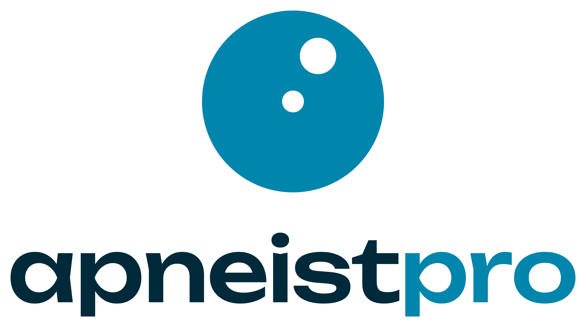
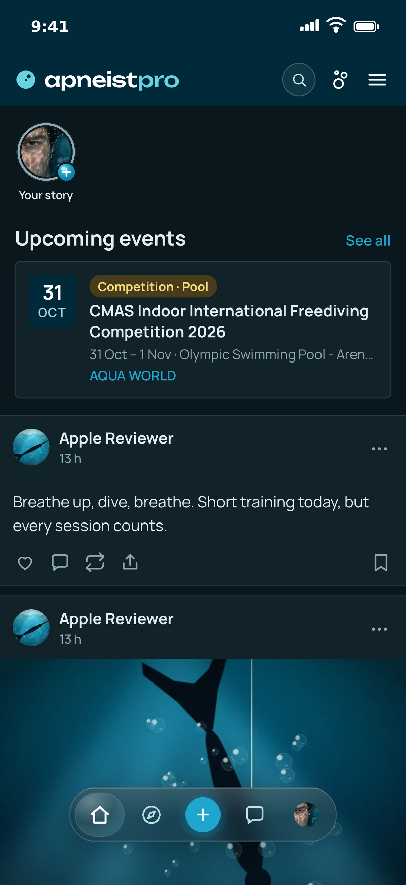
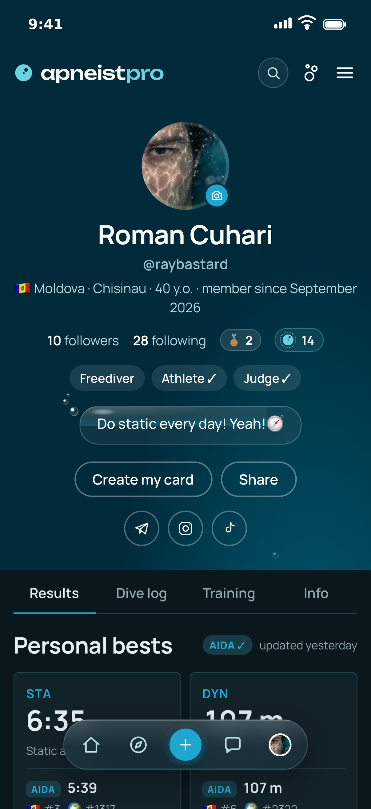
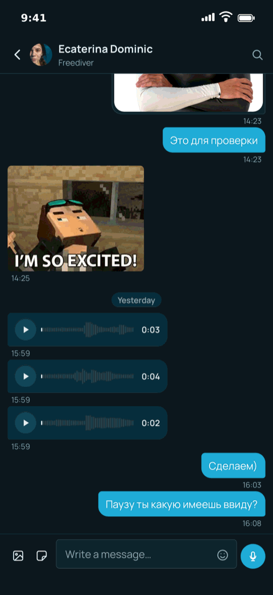
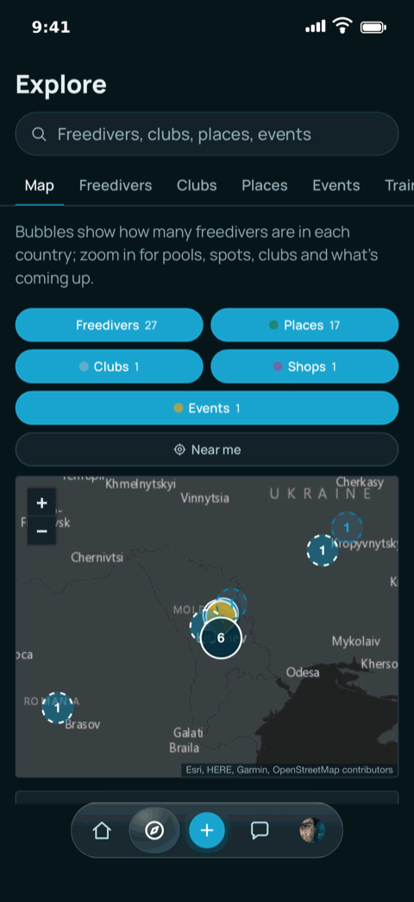

  <picture>
    <source media="(prefers-color-scheme: dark)" srcset="../assets/apneistpro-stacked-on-dark.png">
    
  </picture>

<h3 align="center">The social network for freedivers</h3>

  <a href="https://apneist.pro">apneist.pro</a> ·
  <a href="https://apps.apple.com/app/id6820738668">App Store</a> ·
  <a href="https://t.me/apneistpro">Telegram</a> ·
  <a href="https://instagram.com/apneistpro">Instagram</a>

---

**Apneist Pro** is where freedivers keep their diving — on the web and in a native iOS app. English UI, born in Chișinău, Moldova, meant for the world.

- **Profile** — personal bests and verified certificates, with official AIDA and CMAS results read in on their own
- **Dive log** — sessions with photos and clips, and stories straight from the camera
- **Clubs and schools** — a page each, with their events, chats and athletes
- **Competitions** — the federation calendar, records and rankings
- **Map** — pools and dive spots, wherever you are
- **Messages** — direct chats with voice notes

Opened on 2 October 2026. The iOS app is in review with Apple; Android is next.

  
  
  
  

### For clubs and schools

A club gets its own page: members, events with sign-up, updates, a group chat, the results of its athletes. Write to us from the club's page on the site, or at **clubs@apneist.pro**.

### For the press and partners

Logos, colours and the rules for using them are in the [brand repository](https://github.com/apneistpro/brand). Questions: **hello@apneist.pro**.

### Open

The product's code is private. What is open: the brand kit, and the bugs you find — tell us at [apneist.pro/support](https://apneist.pro/support).

Built solo by <a href="https://github.com/rayBastard">Roman Cuhari</a>, a freediver from Chișinău, with AI in the toolbox · © 2026 Apneist Pro

